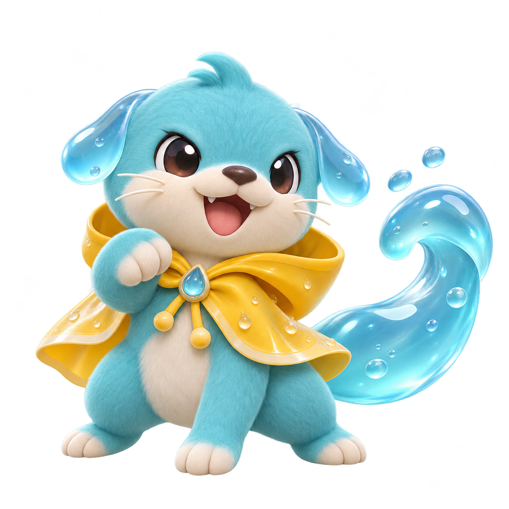
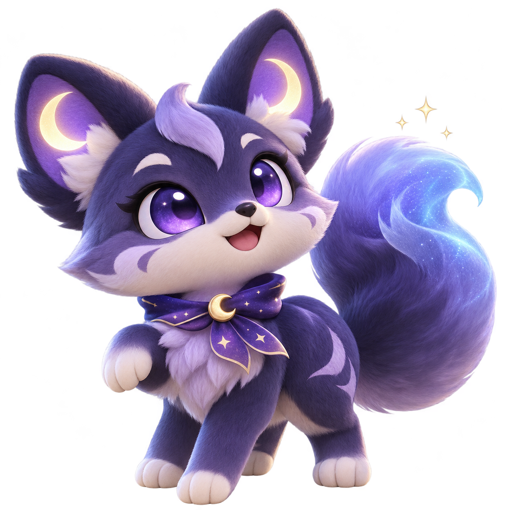
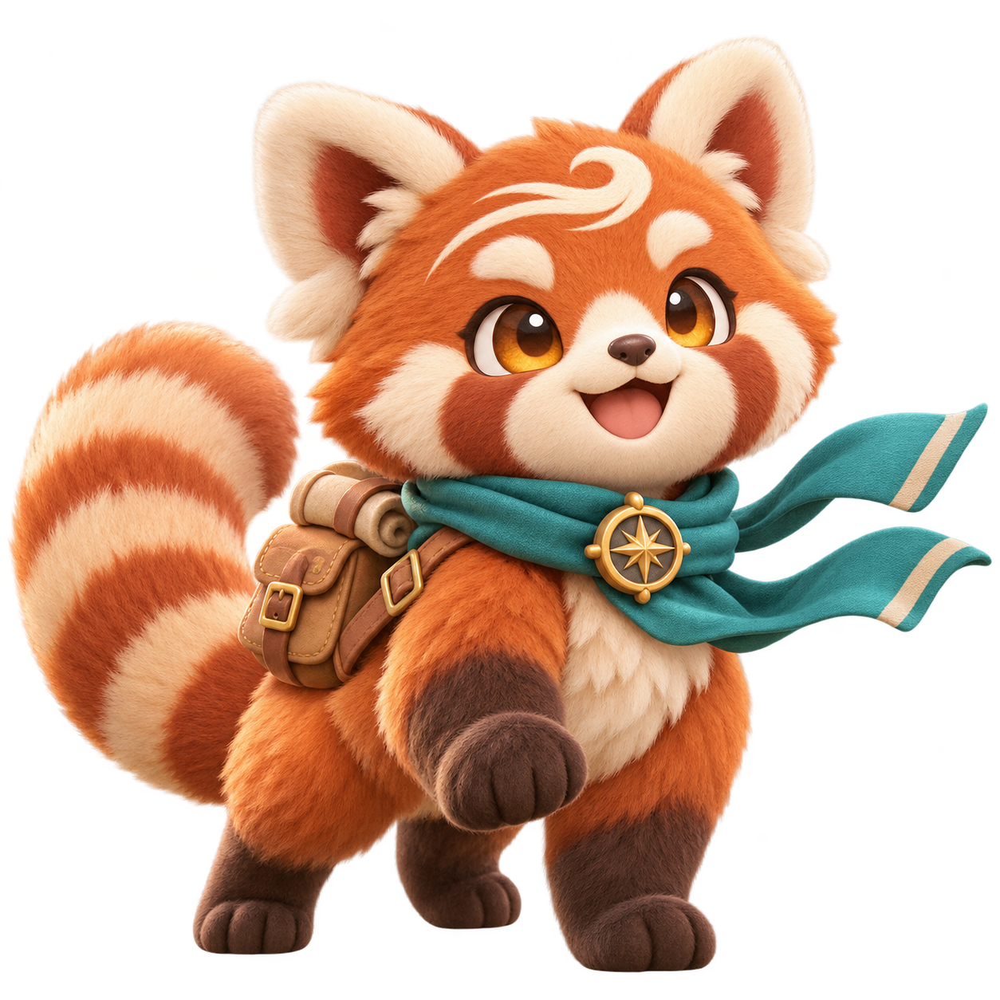

# HitchPet (히치펫)

> 길에서 내 차에 올라타는(히치하이크) 펫을 모으고, 차를 세웠을 때 그 펫으로 휴게소·충전소 같은 랜드마크를 차지하는 Pleos Connect 수집·배틀 게임

현대자동차그룹 차량용 앱 개발 공모전 출품작 · Pleos Connect(Android Automotive OS) 앱 · 현재 기획 단계

## 무엇을 하나요

1. 달리는 동안 히치펫은 차량 신호를 기록합니다. 조건이 맞으면 "새로운 펫이 등장했습니다" 같은 짧은 알림만 띄우고, 운전자에게 확인이나 조작을 요구하지 않습니다.
2. 차를 세워 기어가 P가 되면, 운전자는 알림을 눌러 나타난 펫을 확인하고 도감에 등록합니다. 카드에는 만난 날의 날씨, 시간대, 장소, 누적 주행거리, 함께 탄 사람 수가 기록됩니다.
3. 휴게소나 충전소 같은 랜드마크에서는 그곳을 차지한 다른 운전자의 펫과 3대3 턴제 배틀을 합니다. 상대가 그 자리에 없어도 할 수 있고, 조작은 모두 화면 터치로 합니다.
4. 배틀에서 이기면 그 랜드마크에 운전자의 이름이 올라가고, 펫은 경험치를 얻어 자랍니다.

## 펫의 속성

어떤 속성의 펫이 나타나는지는 차량 신호와 지나온 길로 정해집니다.

| 속성 | 나타나는 조건 | 쓰는 신호 |
| --- | --- | --- |
| 물 | 비를 맞으며 달렸을 때 | 와이퍼 |
| 어둠 | 전조등을 켜고 밤길을 달렸을 때 | 전조등 |
| 빛 | 낮 시간대에 와이퍼 없이 달렸을 때 | 와이퍼, 시간대 |
| 바람 | 한 번에 먼 거리를 달렸을 때 | 주행거리 |
| 바다 | 해안 지역을 지나왔을 때 | 내비게이션 위치 |
| 산 | 산간 지역을 지나왔을 때 | 내비게이션 위치 |
| 도시 | 대도시를 달렸을 때 | 내비게이션 위치 |
| 전기 | 전기차를 충전했거나 충전소 랜드마크에 들렀을 때 | 충전 상태, 위치 |
| 동행 | 2명 이상이 함께 탔을 때 | 좌석 착석 |

상성은 물 → 산 → 바람 → 바다 → 빛 → 어둠 → 도시 → 전기 → 동행 → 물 순서로 이어집니다. 각 속성은 바로 뒤의 두 속성을 이기고(위력 1.5배), 바로 앞의 두 속성에게 집니다(위력 0.75배).

## 펫 캐릭터 시안

| 물 · 비 수달 | 어둠 · 밤 여우 | 바람 · 장거리 레서판다 | 산 · 지역 사슴 |
| --- | --- | --- | --- |
|  |  |  |  |

## Pleos Connect SDK 사용 계획

핵심 기능은 별도 신청 없이 쓸 수 있는 Vehicle SDK 상태 조회, NaviHelper SDK, 안드로이드 표준 API만으로 만듭니다.

| SDK / API | 용도 |
| --- | --- |
| Vehicle Wiper (CAR_WINDOWS), Light (CAR_LIGHTS) | 물, 어둠, 빛 속성 조건 |
| Vehicle Odometer (CAR_DRIVE) | 바람 속성 조건, 희귀 펫 확률, 펫 성장 |
| NaviHelper | 지역 확인(바다, 산, 도시), 랜드마크 도착 확인 |
| Vehicle Gear, AAOS GEAR_SELECTION | 정차 확인, 플레이 화면 열기 |
| Vehicle EvBattery (CAR_ENERGY) | 전기 속성 조건, 충전 중 보상 두 배, 충전 완료 시 배틀 마감 |
| Vehicle Seat (CAR_SEATS) | 동행 속성 조건, 함께 탄 사람 수 |
| AAOS CarUxRestrictionsManager, 알림 API | 주행 중 화면 제한, 짧은 알림 |

## 개발 일정

| 단계 | 내용 |
| --- | --- |
| 첫 버전 (PT 시연) | 9속성 × 2종 = 18종 펫, 휴게소·충전소 랜드마크 배틀, 터치 배틀, 에뮬레이터 Virtual Console 시연 |
| 2단계 | 쇼핑몰·관광지 등 협업 장소 랜드마크, 노선 도장판, 동승자 휴대폰 참여 |
| 3단계 | 외부 IP 시즌 제휴, 해외 Pleos Connect 차량으로 확대 |
